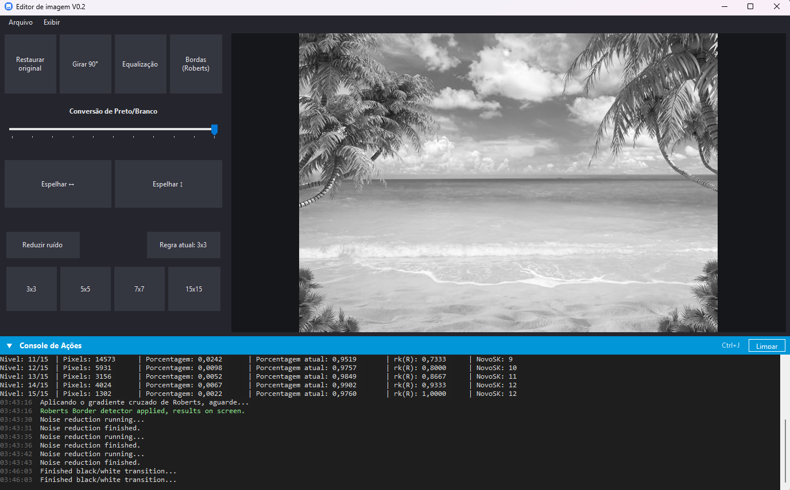

# Image Editor

Desktop image editor built in C# with Windows Forms, to study digital image processing. Every filter is implemented by hand, pixel by pixel, without image libraries.

## Features

| Tool | What it does |
| --- | --- |
| **Rotate 90° / Mirror ↔ ↕** | Geometric transformations |
| **Black and white conversion** | Blends the original image with its grayscale version, controlled by a slider |
| **Reduce noise** | Per-channel median filter, with 3x3, 5x5, 7x7 and 15x15 windows |
| **Equalization** | 16-level histogram with percentages, cumulative values and new levels, printed in the console |
| **Edges (Roberts)** | Edge detection using the Roberts cross gradient |
| **Restore original** | Goes back to the imported image |

Import and export accept BMP, JPG and PNG (**File** menu).

## Interface

- Collapsible **Action Console** at the bottom of the window: **Ctrl+J** opens and closes it. It shows timestamped, color-coded messages (info, success, warning and error) and flags new ones while the panel is closed.
- Resizable window with a dark theme.
- Buttons used without a loaded image warn in the console instead of failing.

## Running

Requires Windows and .NET Framework 4.7.2. Open `TheEditor.sln` in Visual Studio and run (F5), or build from the command line:

```
msbuild TheEditor.sln /p:Configuration=Release
```

The `Lawrence Roberts.png` image in the root is there for trying the filters.

## Structure

| File | Role |
| --- | --- |
| `TheEditor/ImageHandler.cs` | Filters and image transformations |
| `TheEditor/Histogram.cs` | Histogram and equalization calculation |
| `TheEditor/MainWindow.cs` | Button and menu events |
| `TheEditor/MainWindow.Layout.cs` | Window layout and console setup |
| `TheEditor/MainWindow.Theme.cs` | Dark theme, labels and tooltips |
| `TheEditor/ConsoleDrawer.cs` | Collapsible message panel |
